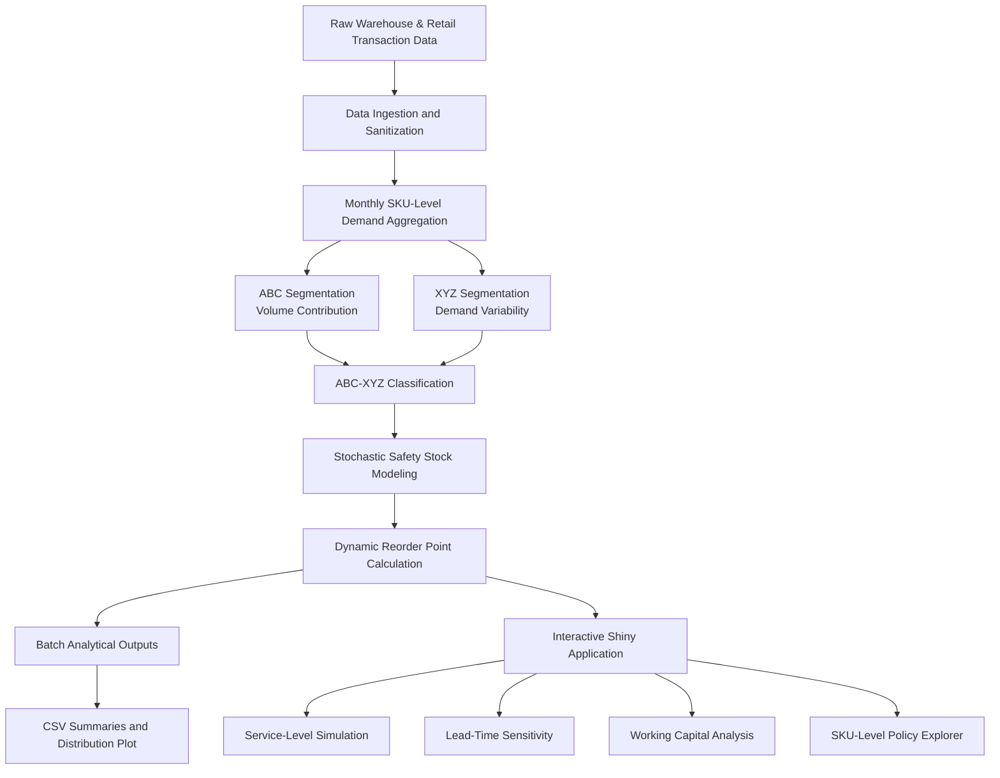
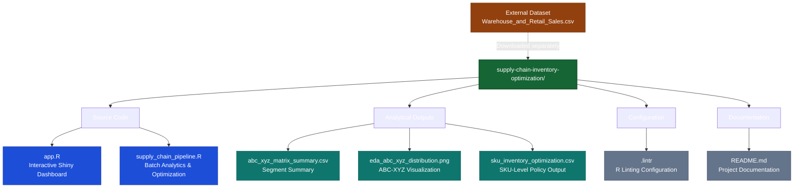

# Supply Chain Inventory Optimization
### ABC-XYZ Demand Segmentation & Stochastic Inventory Policy Engine

An end-to-end R analytics pipeline and interactive Shiny application for SKU-level demand segmentation, stochastic Safety Stock calculation, dynamic Reorder Point (ROP) optimization, and inventory working-capital analysis.

The project combines supply chain analytics, statistical demand classification, and inventory policy simulation to translate historical warehouse and retail movement data into actionable replenishment insights.

---

## 1. Project Overview

Managing thousands of SKUs creates a complex inventory planning problem.

High-volume products require reliable replenishment to reduce stockout exposure, while low-velocity and unpredictable products can tie up working capital through unnecessary inventory.

This project addresses that challenge through an analytical workflow that:

- Analyzes historical SKU-level outbound movement.
- Classifies products using ABC analysis based on cumulative volume contribution.
- Evaluates demand predictability using XYZ segmentation and the Coefficient of Variation (CV).
- Calculates stochastic Safety Stock using demand and supplier lead-time variability.
- Derives dynamic Reorder Points based on target Cycle Service Levels.
- Evaluates inventory policy trade-offs through an interactive Shiny simulation.

**Objective:** Move beyond static inventory thresholds and evaluate replenishment policies according to SKU-level demand characteristics and service-level requirements.

---

## 2. Executive Summary & Key Findings

The analysis covers **38,236 catalog SKUs**, revealing a highly concentrated demand distribution alongside substantial variation in SKU-level demand predictability.

### Portfolio-Level Results

| Metric | Result |
|---|---:|
| Total SKUs analyzed | 38,236 |
| Class A SKUs | 1,486 |
| Class A share of catalog | 3.9% |
| Class AX SKUs | 1,182 |
| High-volume volatile SKUs (AY/AZ) | 304 |
| Class C SKUs | 33,690 |
| Class C share of catalog | 88.1% |
| Class CZ SKUs | 4,499 |

### Key Business Insights

**1. Demand Concentration — Class A**

Just 1,486 SKUs, representing approximately 3.9% of the catalog, account for over 80% of aggregate outbound volume.

Within this group, 1,182 SKUs fall into the AX segment, representing high-volume products with relatively stable demand.

These products are candidates for evaluating standardized replenishment policies, closer inventory monitoring, and potential supplier coordination programs.

**2. High-Volume Demand Variability — AY/AZ**

A total of 304 SKUs fall into the AY and AZ segments.

These products combine high volume contribution with greater demand variability. Their replenishment policies warrant closer evaluation because demand fluctuations can increase exposure to stockouts.

**3. Long-Tail Inventory — Class C**

Class C contains 33,690 SKUs, approximately 88.1% of the catalog, while contributing less than 5% of aggregate volume.

Of these, 4,499 SKUs fall into the CZ segment, indicating low-volume and highly variable demand patterns.

This segment provides an opportunity to investigate alternative replenishment strategies, minimum-order-quantity adjustments, and made-to-order approaches.

> These findings describe the analyzed dataset. Suggested inventory strategies are analytical opportunities, not measured operational savings or guaranteed improvements.

---

## 3. Analytical Architecture

The project follows a batch analytical pipeline connected to an interactive Shiny simulation application.



### Pipeline Components

| Component | Responsibility |
|---|---|
| Data ingestion | Loads and sanitizes transaction records |
| Demand aggregation | Reconciles outbound movement and aggregates SKU activity monthly |
| ABC analysis | Classifies SKUs by cumulative volume contribution |
| XYZ analysis | Evaluates demand predictability using CV |
| Inventory optimization | Calculates Safety Stock and Reorder Points |
| Batch outputs | Generates classification summaries, visualizations and SKU-level policy outputs |
| Shiny application | Enables interactive evaluation of service-level and lead-time assumptions |

---

## 4. Methodology

### 4.1 ABC Analysis — Demand Concentration

SKUs are ranked in descending order of total outbound volume.

The cumulative volume share determines the ABC classification.

Let:

- \(V_i\) = total outbound volume of SKU \(i\)
- \(S_i\) = cumulative volume share up to SKU \(i\)

The classification thresholds are:

\[
\text{ABC Class} =
\begin{cases}
A, & S_i \leq 0.80 \\
B, & 0.80 < S_i \leq 0.95 \\
C, & S_i > 0.95
\end{cases}
\]

| Class | Cumulative Volume Contribution | Interpretation |
|---|---:|---|
| A | First 80% | High-volume SKUs |
| B | Next 15% | Medium-volume SKUs |
| C | Final 5% | Low-volume SKUs |

This segmentation distinguishes products according to their contribution to total outbound volume.

### 4.2 XYZ Analysis — Demand Predictability

Demand variability is evaluated using the Coefficient of Variation (CV) across monthly demand observations.

\[
CV = \frac{\sigma_d}{\mu_d}
\]

Where:

- \(\sigma_d\) = standard deviation of monthly demand
- \(\mu_d\) = mean monthly demand

The implemented classification thresholds are:

\[
\text{XYZ Class} =
\begin{cases}
X, & CV \leq 0.50 \\
Y, & 0.50 < CV \leq 1.00 \\
Z, & CV > 1.00
\end{cases}
\]

| Class | CV Range | Interpretation |
|---|---:|---|
| X | CV ≤ 0.50 | Stable and predictable |
| Y | 0.50 < CV ≤ 1.00 | Variable demand |
| Z | CV > 1.00 | Highly variable or sporadic |

Combining ABC and XYZ produces nine inventory segments representing different combinations of volume contribution and demand predictability.

### 4.3 Stochastic Safety Stock Modeling

Traditional safety-stock calculations often assume constant supplier lead time.

This project extends the calculation to account for both demand variability and supplier lead-time variability.

The implemented model is:

\[
SS = Z \cdot
\sqrt{
\bar{L}\sigma_d^2 +
\bar{d}^{\,2}\sigma_L^2
}
\]

Where:

| Variable | Description |
|---|---|
| \(SS\) | Safety Stock |
| \(Z\) | Standard normal quantile associated with target CSL |
| \(\bar{d}\) | Mean monthly demand |
| \(\sigma_d\) | Standard deviation of monthly demand |
| \(\bar{L}\) | Mean supplier lead time in months |
| \(\sigma_L\) | Standard deviation of supplier lead time in months |

The service-level multiplier is:

\[
Z = \Phi^{-1}(CSL)
\]

Where \(CSL\) represents the target Cycle Service Level.

**Model assumption:** The formulation uses an independence approximation between demand and supplier lead-time variability. It assumes compatible time units and is based on the standard stochastic lead-time demand variance formulation.

### 4.4 Dynamic Reorder Point

The Reorder Point represents the inventory position at which replenishment should be initiated.

\[
ROP = (\bar{d} \times \bar{L}) + SS
\]

The model combines expected demand during replenishment lead time with the calculated safety-stock buffer.

This allows replenishment policies to respond to changes in demand variability, supplier lead time, and target service level.

### 4.5 Working Capital & Carrying Cost Analysis

The project evaluates the financial implications of holding safety stock.

Safety-stock capital is estimated as:

\[
\text{Safety Stock Capital}
=
\sum_i (SS_i \times UnitCost_i)
\]

Annual holding cost is estimated as:

\[
\text{Annual Holding Cost}
=
\text{Safety Stock Capital} \times H
\]

Where \(H\) represents the assumed annual inventory carrying-cost rate.

The project uses an illustrative carrying-cost range of 18%–25%, covering factors such as capital cost, warehousing, insurance, and obsolescence.

Financial outputs depend on the unit-cost inputs and carrying-cost assumptions used in the implementation.

---

## 5. Interactive Shiny Simulation

The project includes an interactive Shiny application designed to explore inventory policy trade-offs.

### Simulation Capabilities

**Cycle Service Level Control**

Adjust target service levels from 80% to 99.9% and evaluate the corresponding safety-stock requirements.

**Lead-Time Sensitivity**

Explore how changes in supplier lead-time assumptions and variability affect replenishment requirements.

**Working Capital Analysis**

Examine the estimated capital implications of different safety-stock policies.

**Holding Cost Evaluation**

Evaluate how inventory carrying-cost assumptions affect modeled holding costs.

**SKU-Level Policy Explorer**

Search and inspect individual SKU inventory recommendations through an interactive DT data table.

The simulation allows users to explore how inventory policy assumptions affect calculated replenishment requirements and modeled costs.

---

## 6. Analytical Visualization

### ABC-XYZ Segmentation Distribution


*Distribution of SKUs across ABC-XYZ demand segments.*

This visualization provides an overview of the relationship between volume contribution and demand variability across the analyzed catalog.

---

## 7. Repository Structure



### External Dataset

The raw transaction dataset is not included in the repository because of its size.

**Dataset:** Montgomery County Warehouse and Retail Sales

Source: [Kaggle](https://www.kaggle.com/)

Download the dataset and place `Warehouse_and_Retail_Sales.csv` in the project root directory before running the pipeline.

---

## 8. Technology Stack

| Technology | Purpose |
|---|---|
| R | Core analytics and data processing |
| tidyverse | Data manipulation and transformation |
| lubridate | Date and time handling |
| scales | Visualization formatting |
| Shiny | Interactive application development |
| bslib | Dashboard interface and styling |
| DT | Interactive SKU-level data tables |
| bsicons | Interface icons |

---

## 9. Setup & Execution

### Prerequisites

- R version 4.2.0 or higher
- RStudio (recommended)
- Source dataset: `Warehouse_and_Retail_Sales.csv`

### Step 1 — Clone the Repository

```bash
git clone https://github.com/AshutoshTembhekar/supply-chain-inventory-optimization.git

cd supply-chain-inventory-optimization
```

### Step 2 — Install Dependencies

Open R or RStudio and execute:

```r
install.packages(c(
  "tidyverse",
  "lubridate",
  "scales",
  "shiny",
  "bslib",
  "DT",
  "bsicons"
))
```

### Step 3 — Add the Source Dataset

Download the Montgomery County Warehouse and Retail Sales dataset from Kaggle.

Place the downloaded file in the repository root and ensure its filename is:

```text
Warehouse_and_Retail_Sales.csv
```

### Step 4 — Run the Batch Pipeline

Execute the data processing and inventory optimization pipeline:

```r
source("supply_chain_pipeline.R")
```

The pipeline generates the analytical outputs, including the ABC-XYZ summary, distribution visualization, and SKU-level inventory optimization results.

### Step 5 — Launch the Shiny Application

Run:

```r
shiny::runApp("app.R")
```

The interactive application will open in your default browser.

---

## 10. Limitations & Modeling Assumptions

- The analysis depends on the quality, completeness, and temporal coverage of the source transaction data.
- ABC classifications are based on historical outbound volume and do not directly measure profitability or revenue contribution.
- XYZ classification depends on the selected monthly aggregation period and CV thresholds.
- The stochastic safety-stock formulation uses an independence approximation between demand and supplier lead-time variability.
- Replenishment recommendations are model outputs and should be evaluated against actual supplier constraints, operational policies, and inventory conditions.
- Working-capital and holding-cost estimates depend on the unit-cost basis and carrying-cost assumptions.
- Historical demand patterns do not guarantee future demand behavior.
- The model should be validated against actual replenishment and stockout history before being used for operational decisions.

---

## 11. Potential Extensions

- Integrate demand forecasting for future inventory planning.
- Introduce SKU-specific service-level policies.
- Compare alternative inventory optimization models.
- Add supplier performance and lead-time reliability analysis.
- Extend the dashboard with historical demand trends and inventory risk monitoring.
- Evaluate replenishment policies using backtesting and simulated stockout scenarios.

---

## Author

**Ashutosh Tembhekar**

Supply Chain Analytics | Data Analytics | Statistical Modeling

- GitHub: [AshutoshTembhekar](https://github.com/AshutoshTembhekar)
- LinkedIn: [Ashutosh Tembhekar](https://www.linkedin.com/in/ashutoshtembhekar/)

---
