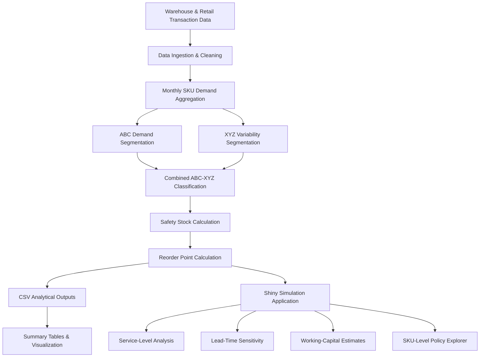

# Supply Chain Inventory Optimization

### ABC-XYZ Demand Segmentation & Stochastic Inventory Policy Engine

An end-to-end R analytics pipeline and interactive Shiny application for SKU-level demand segmentation, stochastic Safety Stock calculation, dynamic Reorder Point (ROP) analysis, and inventory working-capital estimation.

The project uses historical warehouse and retail movement data to examine demand concentration, demand variability, and how different service-level and supplier lead-time assumptions affect inventory requirements.

---

## 1. Project Overview

Managing a large SKU portfolio creates a challenge for inventory planning.

High-volume products require careful replenishment planning to reduce stockout exposure. Meanwhile, products with low or unpredictable demand may require different inventory policies to avoid holding more stock than necessary.

This project develops an analytical workflow to:

- Analyze historical SKU-level outbound movement.
- Classify products using ABC analysis based on cumulative outbound volume.
- Evaluate demand variability using XYZ segmentation.
- Calculate Safety Stock using demand and supplier lead-time variability.
- Estimate Reorder Points based on target Cycle Service Levels.
- Explore inventory policy trade-offs through an interactive Shiny application.
- Estimate the working-capital implications of modeled safety-stock requirements.

**Project objective:** Build a data-driven inventory analysis framework that connects SKU demand characteristics with replenishment policy assumptions.

## 2. Executive Summary & Key Findings

The analysis covers **38,236 SKUs** and identifies substantial concentration in outbound volume, alongside variation in SKU-level demand predictability.

### Portfolio-level results

| Metric | Result |
|---|---:|
| Total SKUs analyzed | 38,236 |
| Class A SKUs | 1,486 |
| Class A share of catalog | 3.9% |
| Class AX SKUs | 1,182 |
| Class AY/AZ SKUs | 304 |
| Class C SKUs | 33,690 |
| Class C share of catalog | 88.1% |
| Class CZ SKUs | 4,499 |

### Key findings

**1. Demand concentration — Class A**

A total of 1,486 SKUs, representing approximately 3.9% of the catalog, account for over 80% of aggregate outbound volume.

Within this group, 1,182 SKUs are classified as AX, combining high volume contribution with relatively stable demand.

These products are candidates for closer replenishment monitoring and more consistent inventory policy evaluation.

**2. High-volume demand variability — AY/AZ**

A total of 304 SKUs fall into the AY and AZ segments.

These products have high volume contribution but comparatively greater demand variability. Their replenishment requirements may therefore be more sensitive to changes in demand and supplier lead times.

**3. Long-tail inventory — Class C**

Class C contains 33,690 SKUs, approximately 88.1% of the catalog, while contributing less than 5% of aggregate outbound volume.

Of these, 4,499 SKUs fall into the CZ segment, indicating low-volume and highly variable demand.

This segment is worth investigating for alternative replenishment approaches, subject to operational constraints and actual inventory costs.

> These findings describe the analyzed dataset. Suggested inventory strategies are analytical opportunities, not measured operational savings or guaranteed improvements.

---

## 3. Analytical Architecture

The workflow consists of a batch analytics pipeline followed by an interactive Shiny application.



### Pipeline components

| Component | Responsibility |
|---|---|
| Data ingestion | Loads and prepares transaction records |
| Demand aggregation | Aggregates SKU activity at monthly intervals |
| ABC analysis | Classifies SKUs by cumulative outbound volume |
| XYZ analysis | Evaluates demand variability using the Coefficient of Variation |
| Inventory modeling | Calculates Safety Stock and Reorder Points |
| Batch outputs | Generates classification summaries and SKU-level results |
| Shiny application | Allows interactive evaluation of inventory assumptions |

---

## 4. Methodology

### 4.1 ABC Analysis — Demand Concentration

SKUs are ranked in descending order of total outbound volume.

The cumulative volume contribution determines the ABC classification.

Let:

- \(V_i\) = total outbound volume of SKU \(i\)
- \(S_i\) = cumulative volume share up to SKU \(i\)

The classification thresholds are:

\[
ABC_i =
\begin{cases}
A, & S_i \leq 0.80 \\
B, & 0.80 < S_i \leq 0.95 \\
C, & S_i > 0.95
\end{cases}
\]

| Class | Cumulative Volume Contribution | Interpretation |
|---|---:|---|
| A | First 80% | High-volume SKUs |
| B | Next 15% | Medium-volume SKUs |
| C | Final 5% | Low-volume SKUs |

This approach identifies products according to their contribution to total outbound volume.

**Important:** ABC classification in this project is volume-based. It should not be interpreted as a classification by revenue, profitability, or gross margin.

### 4.2 XYZ Analysis — Demand Predictability

Demand variability is evaluated using the Coefficient of Variation (CV) across monthly demand observations.

\[
CV = \frac{\sigma_d}{\mu_d}
\]

Where:

- \(\sigma_d\) = standard deviation of monthly demand
- \(\mu_d\) = mean monthly demand

The implemented classification thresholds are:

\[
XYZ_i =
\begin{cases}
X, & CV \leq 0.50 \\
Y, & 0.50 < CV \leq 1.00 \\
Z, & CV > 1.00
\end{cases}
\]

| Class | CV Range | Interpretation |
|---|---:|---|
| X | CV ≤ 0.50 | Relatively stable demand |
| Y | 0.50 < CV ≤ 1.00 | Variable demand |
| Z | CV > 1.00 | Highly variable demand |

Combining ABC and XYZ produces nine inventory segments, each representing a different combination of volume contribution and demand variability.

### 4.3 Stochastic Safety Stock Modeling

A traditional Safety Stock calculation may assume that supplier lead time is constant.

This project uses a formulation that accounts for both demand variability and supplier lead-time variability.

The model is:

\[
SS = Z \times
\sqrt{
\bar{L}\sigma_d^2 +
\bar{d}^{\,2}\sigma_L^2
}
\]

Where:

| Variable | Description |
|---|---|
| \(SS\) | Safety Stock |
| \(Z\) | Standard normal quantile associated with target CSL |
| \(\bar{d}\) | Mean monthly demand |
| \(\sigma_d\) | Standard deviation of monthly demand |
| \(\bar{L}\) | Mean supplier lead time in months |
| \(\sigma_L\) | Standard deviation of supplier lead time in months |

The service-level multiplier is:

\[
Z = \Phi^{-1}(CSL)
\]

Where \(CSL\) represents the target Cycle Service Level.

**Model assumptions:**

- Demand and supplier lead-time variability are treated using an independence approximation.
- Demand and lead-time measurements must use compatible time units.
- The calculation assumes the statistical inputs are representative of the modeled replenishment period.
- The resulting Safety Stock is a model estimate, not a guarantee of a particular realized service level.

### 4.4 Dynamic Reorder Point

The Reorder Point represents the inventory position at which replenishment should be initiated.

\[
ROP = (\bar{d} \times \bar{L}) + SS
\]

Where:

- \(\bar{d}\) = average monthly demand
- \(\bar{L}\) = average supplier lead time in months
- \(SS\) = calculated Safety Stock

The model combines expected demand during supplier lead time with a Safety Stock buffer.

This allows the modeled Reorder Point to change when demand, lead-time assumptions, or target service levels change.

### 4.5 Working Capital & Carrying Cost Analysis

The project estimates the capital associated with holding calculated Safety Stock.

Safety Stock capital is estimated as:

\[
\text{Safety Stock Capital}
=
\sum_i (SS_i \times UnitCost_i)
\]

Annual holding cost is estimated as:

\[
\text{Annual Holding Cost}
=
\text{Safety Stock Capital} \times H
\]

Where:

- \(SS_i\) = Safety Stock for SKU \(i\)
- \(UnitCost_i\) = unit-cost input used for SKU \(i\)
- \(H\) = assumed annual inventory carrying-cost rate

The project uses an illustrative carrying-cost range of **18%–25%**.

This range represents an assumption for scenario analysis, not a measured carrying-cost rate for a specific business.

Financial estimates depend on the unit-cost inputs and carrying-cost assumptions used in the implementation. They should not be interpreted as realized working-capital savings.

---

## 5. Interactive Shiny Simulation

The project includes an interactive Shiny application for exploring inventory policy assumptions and their effects on calculated inventory requirements.

### Simulation capabilities

**Cycle Service Level Control**

Adjust target service levels from 80% to 99.9% and examine how the Safety Stock requirement changes.

**Lead-Time Sensitivity**

Explore the effect of supplier lead-time assumptions and variability on replenishment requirements.

**Working Capital Analysis**

Examine estimated Safety Stock capital under different inventory policy assumptions.

**Holding Cost Evaluation**

Evaluate how different carrying-cost assumptions affect modeled annual holding costs.

**SKU-Level Policy Explorer**

Search and inspect individual SKU-level inventory outputs through an interactive DT data table.

The application is intended for analytical exploration. Its outputs depend on the input data and assumptions used in the underlying model.

---

## 6. Analytical Visualization

### ABC-XYZ Segmentation Distribution


*Distribution of SKUs across ABC-XYZ demand segments.*

The visualization provides an overview of how the analyzed SKU portfolio is distributed across volume-contribution and demand-variability categories.

---

## 7. Dataset

The project uses the **Montgomery County Warehouse and Retail Sales** dataset.

The raw transaction file is not included in this repository because of its size.

**Dataset source:** Kaggle

To locate the dataset, search Kaggle for:

`Montgomery County Warehouse and Retail Sales`

Download the source file and place it in the project root directory.

The expected filename is:

`Warehouse_and_Retail_Sales.csv`

The pipeline requires the source file to be available locally before execution.

---

## 8. Repository Structure

```text
supply-chain-inventory-optimization/
│
├── app.R
├── supply_chain_pipeline.R
├── abc_xyz_matrix_summary.csv
├── eda_abc_xyz_distribution.png
├── sku_inventory_optimization.csv
├── .lintr
└── README.md
```

| File | Description |
|---|---|
| `supply_chain_pipeline.R` | Data processing, demand segmentation, and inventory calculations |
| `app.R` | Interactive Shiny application |
| `abc_xyz_matrix_summary.csv` | ABC-XYZ classification summary |
| `eda_abc_xyz_distribution.png` | Segmentation distribution visualization |
| `sku_inventory_optimization.csv` | SKU-level inventory policy outputs |
| `.lintr` | R linting configuration |
| `README.md` | Project documentation |

**Note:** The source dataset, `Warehouse_and_Retail_Sales.csv`, must be downloaded separately and is not included in the repository.

---

## 9. Technology Stack

| Technology | Purpose |
|---|---|
| R | Core analytics and data processing |
| tidyverse | Data manipulation and transformation |
| lubridate | Date and time handling |
| scales | Visualization formatting |
| Shiny | Interactive application development |
| bslib | Dashboard interface and styling |
| DT | Interactive SKU-level data tables |
| bsicons | Interface icons |

---

## 10. Setup & Execution

### Prerequisites

- R version 4.2.0 or higher
- RStudio (recommended)
- Source dataset: `Warehouse_and_Retail_Sales.csv`

### Step 1 — Clone the repository

```bash
git clone https://github.com/AshutoshTembhekar/supply-chain-inventory-optimization.git

cd supply-chain-inventory-optimization
```

### Step 2 — Install dependencies

Open R or RStudio and execute:

```r
install.packages(c(
  "tidyverse",
  "lubridate",
  "scales",
  "shiny",
  "bslib",
  "DT",
  "bsicons"
))
```

### Step 3 — Add the source dataset

Download the Montgomery County Warehouse and Retail Sales dataset from Kaggle.

Place the downloaded CSV file in the repository root directory.

Ensure the filename is:

```text
Warehouse_and_Retail_Sales.csv
```

### Step 4 — Run the analytical pipeline

Execute:

```r
source("supply_chain_pipeline.R")
```

The pipeline processes the source data and generates the analytical outputs, including the ABC-XYZ summary, distribution visualization, and SKU-level inventory optimization results.

### Step 5 — Launch the Shiny application

Run:

```r
shiny::runApp("app.R")
```

The Shiny application should open in your default browser.

---

## 11. Limitations & Modeling Assumptions

The results should be interpreted in the context of the following limitations:

- The analysis depends on the quality, completeness, and temporal coverage of the source transaction data.
- ABC classifications are based on historical outbound volume, not revenue or profitability.
- XYZ classification depends on the monthly aggregation period and selected CV thresholds.
- Historical demand patterns may not represent future demand behavior.
- The stochastic Safety Stock formulation uses an independence approximation between demand and supplier lead-time variability.
- The model assumes compatible units for demand and lead-time inputs.
- Replenishment recommendations are analytical outputs and should be evaluated against actual supplier constraints, operational policies, and inventory conditions.
- Working-capital and holding-cost estimates depend on the unit-cost basis and carrying-cost assumptions.
- The model should be validated against actual replenishment and stockout history before being used for operational decisions.

---

## 12. Potential Extensions

Potential areas for further development include:

- Integrating demand forecasting into inventory planning.
- Introducing SKU-specific service-level policies.
- Comparing alternative Safety Stock and inventory optimization models.
- Adding supplier performance and lead-time reliability analysis.
- Extending the dashboard with historical demand trends and inventory risk monitoring.
- Evaluating replenishment policies through backtesting and simulated stockout scenarios.

---

## Author

**Ashutosh Tembhekar**

Supply Chain Analytics | Data Analytics | Statistical Modeling

- GitHub: [AshutoshTembhekar](https://github.com/AshutoshTembhekar)
- LinkedIn: [Ashutosh Tembhekar](https://www.linkedin.com/in/ashutoshtembhekar/)

---

