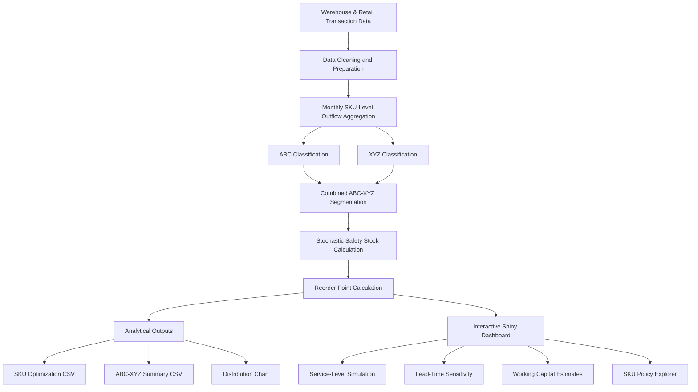
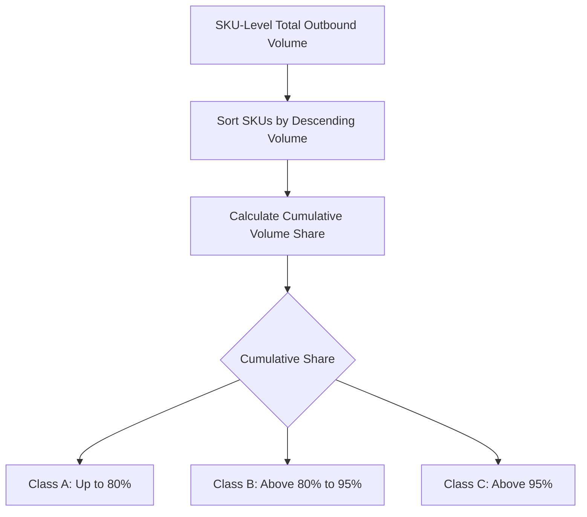
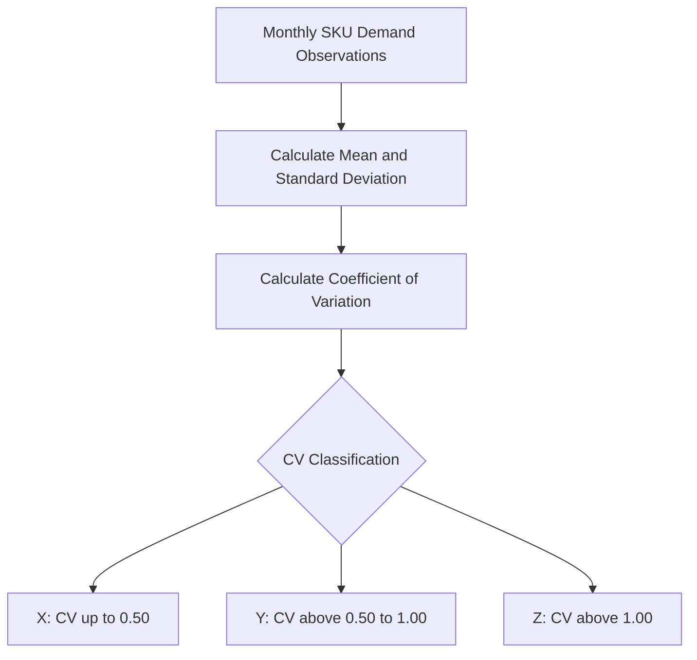
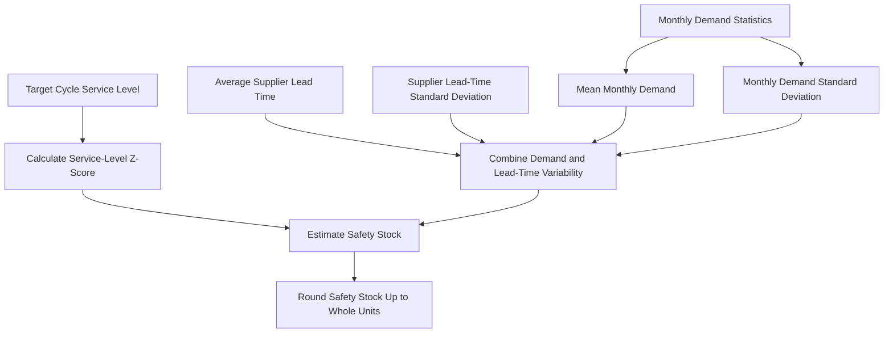
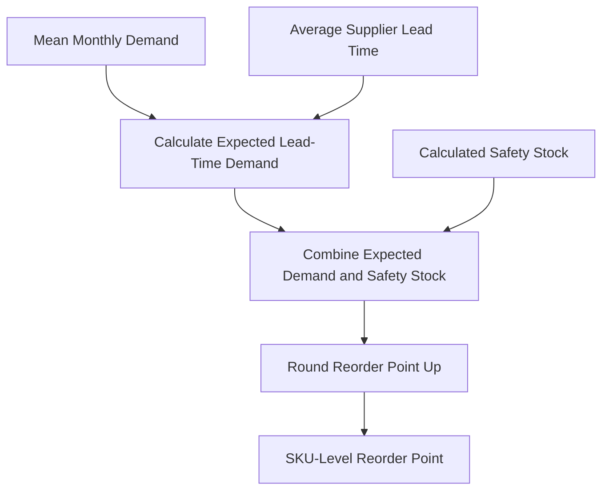
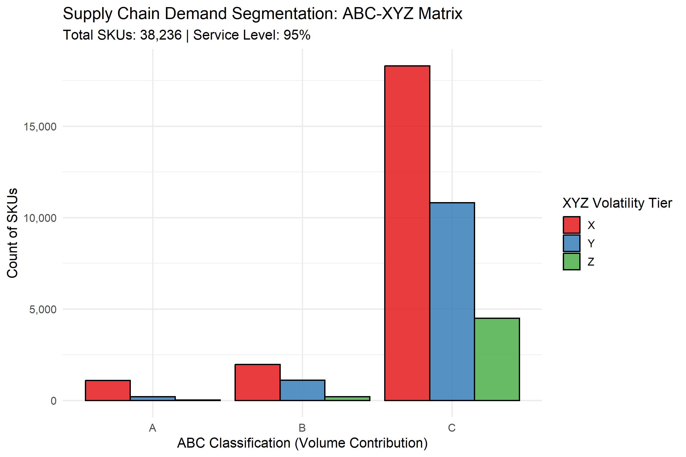
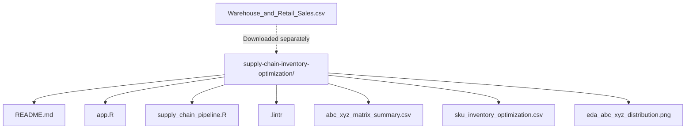

# Supply Chain Inventory Optimization

### ABC-XYZ Demand Segmentation & Stochastic Inventory Policy Modeling

An end-to-end supply chain analytics project built using R and Shiny. This project analyzes historical warehouse and retail movement data, classifies SKUs using ABC-XYZ segmentation, estimates Safety Stock and Reorder Points under demand and supplier lead-time uncertainty, and provides an interactive dashboard to explore inventory policy assumptions.

The objective is to translate historical SKU-level demand patterns into structured inventory planning insights.

---

## 1. Project Overview

Managing a large product portfolio creates different inventory planning challenges.

- High-volume products require careful replenishment planning.
- Products with volatile demand require greater attention to inventory buffers.
- Low-volume products may require different replenishment approaches from high-volume products.

This project addresses these challenges through an analytical workflow that:

- Processes historical warehouse and retail movement data.
- Aggregates SKU-level outbound movement by month.
- Classifies products using ABC analysis.
- Evaluates demand variability using XYZ segmentation.
- Calculates Safety Stock using demand and supplier lead-time variability.
- Derives Reorder Points based on target Cycle Service Levels.
- Estimates inventory capital and carrying costs using configurable assumptions.
- Provides an interactive Shiny dashboard for inventory policy exploration.

**Project objective:** Understand how demand characteristics, supplier lead-time assumptions, and target service levels influence inventory requirements.

---

## 2. Dataset

The project uses the Montgomery County Warehouse and Retail Sales dataset.

**Dataset filename:** `Warehouse_and_Retail_Sales.csv`

The source dataset is not included in this repository. Download it separately and place it in the project root directory.

Dataset source: [Kaggle - Montgomery County Warehouse and Retail Sales](https://www.kaggle.com/)

The dataset contains fields relating to:

- Year and month
- Supplier
- Item code and description
- Item type
- Retail sales
- Warehouse sales
- Retail transfers

### Data Preparation

The pipeline performs the following preparation steps:

- Standardizes column names.
- Replaces missing supplier names with `UNKNOWN SUPPLIER`.
- Replaces missing item types with `OTHER`.
- Replaces missing retail sales values with zero.
- Calculates total outbound movement from retail sales, warehouse sales, and retail transfers.
- Aggregates outbound movement at SKU-month level.

Historical outbound movement is used as a proxy for demand in this analysis.

---

## 3. Executive Summary & Key Findings

The analyzed dataset contains **38,236 catalog SKUs**.

### Portfolio Overview

| Metric | Result |
|---|---:|
| Total SKUs analyzed | 38,236 |
| Class A SKUs | 1,486 |
| Class A share of catalog | 3.9% |
| Class AX SKUs | 1,182 |
| High-volume volatile SKUs (AY/AZ) | 304 |
| Class C SKUs | 33,690 |
| Class C share of catalog | 88.1% |
| Class CZ SKUs | 4,499 |

### Key Business Insights

**1. Demand Concentration — Class A**

Approximately 3.9% of the catalog belongs to Class A and accounts for over 80% of aggregate outbound volume.

Within this group, 1,182 SKUs belong to the AX segment, combining high volume contribution with relatively stable observed demand.

These products are candidates for closer inventory monitoring and standardized replenishment policy evaluation.

**2. High-Volume Demand Variability — AY/AZ**

A total of 304 SKUs fall into the AY and AZ segments.

These products combine high volume contribution with greater demand variability. Their replenishment assumptions warrant closer evaluation because fluctuations in demand can increase exposure to stockouts.

**3. Long-Tail Inventory — Class C**

Class C contains 33,690 SKUs, approximately 88.1% of the catalog, while contributing less than 5% of aggregate volume.

Of these, 4,499 SKUs belong to the CZ segment.

This segment provides an opportunity to investigate alternative replenishment approaches, supplier minimum-order quantities, and made-to-order strategies.

> These findings describe the analyzed dataset. Suggested inventory strategies are analytical opportunities, not measured operational savings or guaranteed improvements.

---

## 4. Analytical Architecture

The project follows a batch analytics workflow connected to an interactive Shiny application.



### Pipeline Components

| Component | Responsibility |
|---|---|
| Data ingestion | Loads and prepares transaction records |
| Demand aggregation | Calculates monthly SKU-level outbound movement |
| ABC analysis | Classifies SKUs by cumulative volume contribution |
| XYZ analysis | Evaluates demand variability |
| Inventory modeling | Calculates Safety Stock and Reorder Points |
| Batch outputs | Generates summary files and visualizations |
| Shiny dashboard | Enables interactive inventory policy analysis |

---

## 5. Methodology

### 5.1 ABC Analysis — Demand Concentration

ABC analysis classifies SKUs according to their contribution to total outbound volume.

The process:

1. Calculate total outbound volume for each SKU.
2. Rank SKUs in descending order of volume.
3. Calculate cumulative volume contribution.
4. Assign ABC classes using the selected thresholds.



| Class | Cumulative Volume Contribution | Interpretation |
|---|---|---|
| A | First 80% | High-volume SKUs |
| B | Next 15% | Medium-volume SKUs |
| C | Final 5% | Low-volume SKUs |

### 5.2 XYZ Analysis — Demand Predictability

XYZ classification evaluates the variability of monthly SKU-level demand.

The project uses the Coefficient of Variation (CV), which compares the standard deviation of observed monthly demand with its mean.

| Class | CV Threshold | Interpretation |
|---|---|---|
| X | CV up to 0.50 | Relatively stable demand |
| Y | Above 0.50 to 1.00 | Variable demand |
| Z | Above 1.00 | Highly variable demand |



### 5.3 Combined ABC-XYZ Segmentation

Combining both classifications produces nine inventory segments.

| Segment | Interpretation |
|---|---|
| AX | High volume, relatively stable demand |
| AY | High volume, variable demand |
| AZ | High volume, highly variable demand |
| BX | Medium volume, relatively stable demand |
| BY | Medium volume, variable demand |
| BZ | Medium volume, highly variable demand |
| CX | Low volume, relatively stable demand |
| CY | Low volume, variable demand |
| CZ | Low volume, highly variable demand |

This matrix helps distinguish SKUs according to both volume contribution and demand predictability.

### 5.4 Stochastic Safety Stock Modeling

The inventory model accounts for two sources of uncertainty:

- Variation in monthly demand.
- Variation in supplier lead time.

The model uses a target Cycle Service Level (CSL) to determine the service-level multiplier used in Safety Stock estimation.

The calculation considers:

- Average monthly demand.
- Standard deviation of monthly demand.
- Average supplier lead time.
- Standard deviation of supplier lead time.
- Target Cycle Service Level.

The model assumes demand variability and supplier lead-time variability are independent.

All demand and lead-time inputs are expressed in consistent monthly units.



Safety Stock increases when the model assumes greater demand variability, greater supplier lead-time variability, or a higher target service level.

### 5.5 Reorder Point Calculation

The Reorder Point represents the inventory position at which replenishment should be initiated.

The model combines:

- Expected demand during the assumed supplier lead time.
- The calculated Safety Stock buffer.



### 5.6 Working Capital and Carrying Cost Analysis

The dashboard estimates the capital associated with the modeled Safety Stock requirement.

It also estimates annual inventory carrying costs using a user-selected carrying-cost rate.

**Dashboard assumptions:**

- Illustrative average unit cost defaults to $15.
- The unit-cost assumption can be changed by the user.
- Annual carrying-cost rate can be adjusted from 10% to 40%.
- Default annual carrying-cost rate is 22%.

These are scenario assumptions, not actual SKU-specific procurement costs or audited financial savings.

---

## 6. Interactive Shiny Dashboard

The project includes a Shiny application for exploring how inventory policy assumptions affect calculated inventory requirements.

### Dashboard Capabilities

**Cycle Service Level Control**

Adjust the target service level from 80% to 99.9%.

**Supplier Lead-Time Sensitivity**

Change average supplier lead time from 0.5 to 3 months.

**Lead-Time Variability**

Adjust supplier lead-time standard deviation from 0 to 1 month.

**Working Capital Estimation**

Explore the estimated capital associated with the calculated Safety Stock.

**Annual Carrying Cost**

Change the assumed annual carrying-cost rate from 10% to 40%.

**SKU-Level Policy Explorer**

Filter products by item type and ABC-XYZ segment. Inspect calculated demand statistics, Safety Stock, Reorder Points, and estimated financial values.

The dashboard recalculates inventory policies based on the selected inputs.

---

## 7. Analytical Visualization

### ABC-XYZ Segmentation Distribution



*Distribution of SKUs across ABC-XYZ demand segments.*

The visualization provides an overview of the relationship between volume contribution and demand variability across the analyzed catalog.

---

## 8. Repository Structure



| File | Description |
|---|---|
| `README.md` | Project documentation |
| `app.R` | Interactive Shiny dashboard |
| `supply_chain_pipeline.R` | Batch analytics and inventory optimization pipeline |
| `abc_xyz_matrix_summary.csv` | ABC-XYZ segment distribution summary |
| `sku_inventory_optimization.csv` | SKU-level inventory policy results |
| `eda_abc_xyz_distribution.png` | ABC-XYZ distribution visualization |
| `.lintr` | R linting configuration |

The source dataset is downloaded separately and is not included in the repository.

---

## 9. Technology Stack

| Technology | Purpose |
|---|---|
| R | Core analytical programming |
| tidyverse | Data manipulation and transformation |
| readr | CSV data ingestion and export |
| dplyr | Data processing and aggregation |
| tidyr | Data reshaping |
| lubridate | Date handling |
| ggplot2 | Analytical visualization |
| scales | Numeric and chart formatting |
| Shiny | Interactive dashboard |
| bslib | Dashboard interface |
| DT | Interactive data tables |
| bsicons | Dashboard icons |

---

## 10. Setup and Execution

### Prerequisites

- R version 4.2.0 or higher.
- RStudio recommended.
- Source dataset: `Warehouse_and_Retail_Sales.csv`.

### Step 1 — Clone the Repository

```bash
git clone https://github.com/AshutoshTembhekar/supply-chain-inventory-optimization.git

cd supply-chain-inventory-optimization
```

### Step 2 — Install Dependencies

Run the following command in R or RStudio:

```r
install.packages(c(
  "tidyverse",
  "lubridate",
  "scales",
  "shiny",
  "bslib",
  "DT",
  "bsicons"
))
```

### Step 3 — Add the Dataset

Download the Montgomery County Warehouse and Retail Sales dataset.

Place the file in the project root directory with the following name:

```text
Warehouse_and_Retail_Sales.csv
```

### Step 4 — Run the Analytical Pipeline

Execute:

```r
source("supply_chain_pipeline.R")
```

The pipeline generates:

- `sku_inventory_optimization.csv`
- `abc_xyz_matrix_summary.csv`
- `eda_abc_xyz_distribution.png`

These files should be written to the repository root directory.

### Step 5 — Launch the Shiny Dashboard

Execute:

```r
shiny::runApp("app.R")
```

The interactive dashboard will open in your default browser.

---

## 11. Limitations and Modeling Assumptions

- The analysis depends on the completeness and quality of the source transaction data.
- Historical outbound movement is used as a proxy for demand.
- ABC classification is based on volume contribution, not revenue or profitability.
- XYZ classification depends on the observed monthly demand periods and selected CV thresholds.
- SKU-month combinations with no recorded transaction are not explicitly generated as zero-demand observations in the current aggregation workflow.
- SKUs are grouped using item code, description, item type, and supplier. Changes in these attributes can result in separate analytical groups.
- The Safety Stock model assumes independence between demand and supplier lead-time variability.
- The model uses assumed lead-time parameters rather than historical supplier-specific lead-time distributions.
- Working-capital and carrying-cost estimates use an illustrative average unit cost and user-selected carrying-cost assumptions.
- Replenishment recommendations are model outputs and should be validated against actual inventory positions, supplier constraints, and operational requirements.
- Historical demand patterns do not guarantee future demand behavior.

---

## 12. Potential Extensions

- Generate a complete SKU-month panel to explicitly account for zero-demand periods.
- Introduce SKU-specific service-level policies.
- Incorporate supplier-level historical lead-time distributions.
- Integrate demand forecasting into replenishment planning.
- Compare alternative inventory optimization approaches.
- Add inventory risk monitoring and historical demand trend analysis.
- Backtest replenishment policies using historical stockout and replenishment data.

---

## Author

**Ashutosh Tembhekar**

Supply Chain Analytics | Data Analytics | Statistical Modeling

- GitHub: [AshutoshTembhekar](https://github.com/AshutoshTembhekar)
- LinkedIn: [Ashutosh Tembhekar](https://www.linkedin.com/in/ashutoshtembhekar/)

---
