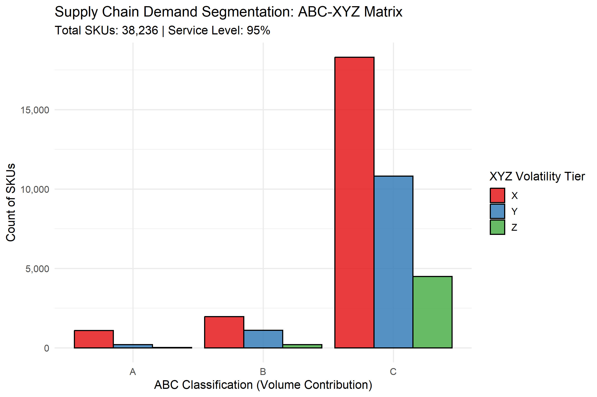

# Enterprise Supply Chain Analytics: Stochastic Inventory Optimization Engine

An end-to-end R analytics pipeline and interactive Shiny simulation platform. This system ingests multi-year transactional retail sales and warehouse movement logs, executes multi-echelon demand segmentation using an ABC-XYZ Matrix, and calculates stochastic Safety Stock and dynamic Reorder Points (ROP) under simultaneous demand and supplier lead-time uncertainty.



---

## Data Source

The raw transaction dataset (`Warehouse_and_Retail_Sales.csv`) exceeds GitHub's direct upload threshold.
* **Download:** [Retail Sales Dataset on Kaggle](https://www.kaggle.com/datasets/surajjha101/stores-area-and-sales-data) *(Montgomery County Warehouse and Retail Sales)*
* **Setup:** Place `Warehouse_and_Retail_Sales.csv` in the project root directory before running the batch pipeline or Shiny application.

---

## Executive Summary & Core Insights

Analysis across **38,236 catalog SKUs** highlights significant demand skewness and volatility clustering:

* **Class A Concentration (3.9% of SKUs):** Over 80% of aggregate outbound volume is driven by 1,486 items. Among these, **1,182 SKUs belong to Class AX** (high volume, low volatility), representing the primary candidates for Automated Replenishment Programs, Vendor-Managed Inventory (VMI), and Just-In-Time (JIT) scheduling.
* **Top-Line Stockout Vulnerability (AY / AZ - 304 SKUs):** High-volume items characterized by volatile or sporadic order profiles require buffered safety stock to mitigate stockouts against key revenue drivers.
* **Long-Tail Rationalization (Class C - 88.1% of SKUs):** 33,690 low-velocity SKUs contribute under 5% of aggregate system volume. **4,499 SKUs reside in Class CZ** (erratic/lumpy demand), identifying opportunities for supplier SKU rationalization, minimum order quantity (MOQ) re-negotiations, or shifting toward Made-to-Order (MTO) fulfillment to release trapped working capital.

---

## Architectural Pipeline

```text
Raw Transaction Logs (Warehouse & Retail Outflows)
                       │
                       ▼
    [ Data Ingestion & Sanitization Engine ]
      • Missing value imputation
      • Outflow reconciliation (Sales + Warehouse Transfers)
      • Monthly temporal aggregation
                       │
                       ▼
    [ ABC-XYZ Multi-Echelon Demand Segmentation ]
      • Pareto volume concentration (Cumulative share: 80% / 15% / 5%)
      • Coefficient of Variation (CV) tiering (X: <=0.5, Y: 0.5-1.0, Z: >1.0)
                       │
                       ▼
    [ Stochastic Inventory Policy Optimization ]
      • Lead-time variance propagation
      • Dynamic Z-score scaling via Cycle Service Level (CSL)
      • Safety Stock & Reorder Point (ROP) derivation
                       │
         ┌─────────────┴─────────────┐
         ▼                           ▼
[ Automated Batch Outputs ]   [ Interactive Shiny Simulation Platform ]
• eda_abc_xyz_distribution.png  • Real-time Cycle Service Level slider (80% - 99.9%)
• abc_xyz_matrix_summary.csv    • Live supplier lead-time & variance sensitivity
• sku_inventory_optimization.csv • Interactive working capital & holding cost KPIs
                                • Searchable SKU-level policy explorer (DT)
```

---


## Mathematical Formulation

### 1. ABC Segmentation (Pareto Principle)
SKUs are sorted descending by cumulative total volume $V_i$. The cumulative volume share $S_i$ establishes the classification tier:

$$\text{Class} = \begin{cases} 
A, & S_i \le 0.80 \\ 
B, & 0.80 < S_i \le 0.95 \\ 
C, & S_i > 0.95 
\end{cases}$$

### 2. XYZ Segmentation (Demand Predictability)
Evaluated across monthly aggregation windows using the statistical **Coefficient of Variation (CV)**:

$$CV = \frac{\sigma_d}{\mu_d}$$

$$\text{Volatility Tier} = \begin{cases} 
X \text{ (Stable / Predictable)}, & CV \le 0.50 \\ 
Y \text{ (Variable / Seasonal)}, & 0.50 < CV \le 1.00 \\ 
Z \text{ (Sporadic / Lumpy)}, & CV > 1.00 
\end{cases}$$

### 3. Stochastic Safety Stock Modeling
To prevent stockouts during replenishment cycles, the safety stock model accounts for both customer demand variability ($\sigma_d$) and supplier lead-time variability ($\sigma_L$):

$$SS = Z \cdot \sqrt{\overline{L} \cdot \sigma_d^2 + \overline{d}^2 \cdot \sigma_L^2}$$

Where:
* $Z = \Phi^{-1}(\text{CSL})$: Inverse standard normal cumulative distribution function for target Cycle Service Level.
* $\overline{d}$: Mean monthly demand.
* $\sigma_d$: Standard deviation of monthly demand.
* $\overline{L}$: Mean supplier lead time (in months).
* $\sigma_L$: Standard deviation of supplier lead time (in months).

### 4. Dynamic Reorder Point (ROP)
$$\text{ROP} = (\overline{d} \cdot \overline{L}) + SS$$

### 5. Working Capital & Carrying Cost Dynamics
$$\text{Safety Stock Capital} = \sum (SS_i \times \text{Unit Cost})$$
$$\text{Annual Holding Cost} = \text{Safety Stock Capital} \times H$$

Where $H$ represents the annual carrying cost rate (typically 18%–25% covering capital cost, warehousing, insurance, and obsolescence).

---


## Repository Structure

```text
.
├── app.R                           # Interactive Shiny dashboard (bslib, DT, bsicons)
├── supply_chain_pipeline.R         # Batch data processing & optimization script
├── abc_xyz_matrix_summary.csv      # Segment distribution counts
├── eda_abc_xyz_distribution.png    # High-resolution ABC-XYZ distribution plot
├── sku_inventory_optimization.csv  # Granular SKU policy output (SS, ROP, CV)
├── .lintr                          # Linter configuration
├── .gitignore                      # Git ignore rules
└── README.md                       # Architectural and mathematical documentation
```

---

## Setup & Execution

### Prerequisites
* R (>= 4.2.0)
* Install required packages:
```r
install.packages(c("tidyverse", "lubridate", "scales", "shiny", "bslib", "DT", "bsicons"))
```

### 1. Data Setup
Place the source dataset (`Warehouse_and_Retail_Sales.csv`) into the project root directory.

### 2. Run the Batch Pipeline
Execute the autonomous ETL to calculate matrix distributions and generate summary CSVs and charts:
```r
source("supply_chain_pipeline.R")
```

### 3. Launch the Interactive Dashboard
Launch the simulation application to test service-level trade-offs and evaluate capital commitments in real time:
```r
shiny::runApp("app.R")
```

---

## Author & Project Lead

**Ashutosh Tembhekar**  
*Data & Supply Chain Analytics Professional*  

* **Domain Specialization:** Enterprise Supply Chain Analytics, Demand Forecasting & Segmentation (ABC-XYZ), Stochastic Inventory Policy Modeling, and ERP Data Pipeline Integration.
* **Technical Toolchain:** R (tidyverse, Shiny, bslib, DT), Python (Exploratory Data Analysis, Machine Learning), Power BI, SQL, JSON.
* **Professional Background:** Analytics & Data Engineering practitioner specializing in bridging commercial operations, supply chain logistics, and production-grade business intelligence applications.

[](https://github.com/AshutoshTembhekar)
[](https://github.com/AshutoshTembhekar?tab=repositories)
