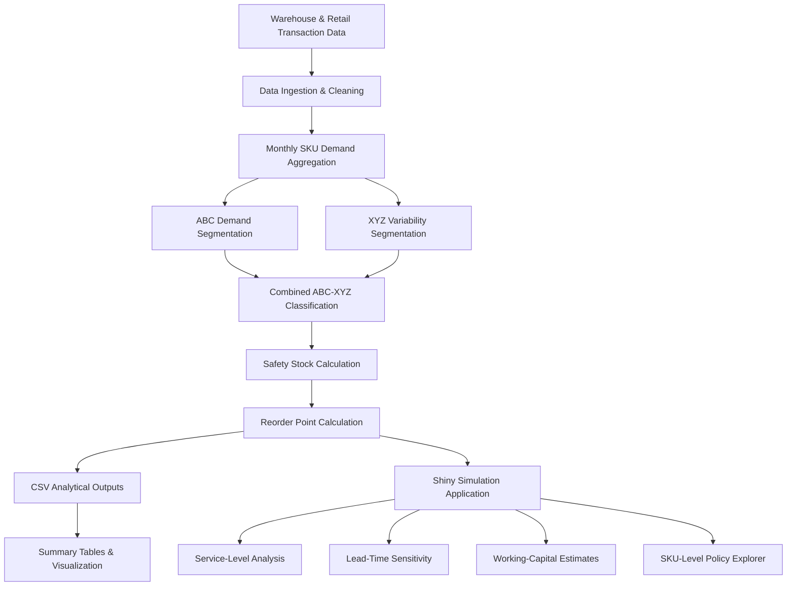

# Supply Chain Inventory Optimization

### ABC-XYZ Demand Segmentation & Stochastic Inventory Policy Engine

An end-to-end R analytics pipeline and interactive Shiny application for SKU-level demand segmentation, stochastic Safety Stock calculation, dynamic Reorder Point (ROP) analysis, and inventory working-capital estimation.

The project uses historical warehouse and retail movement data to examine demand concentration, demand variability, and how different service-level and supplier lead-time assumptions affect inventory requirements.

---

## 1. Project Overview

Managing a large SKU portfolio creates a challenge for inventory planning.

High-volume products require careful replenishment planning to reduce stockout exposure. Meanwhile, products with low or unpredictable demand may require different inventory policies to avoid holding more stock than necessary.

This project develops an analytical workflow to:

- Analyze historical SKU-level outbound movement.
- Classify products using ABC analysis based on cumulative outbound volume.
- Evaluate demand variability using XYZ segmentation.
- Calculate Safety Stock using demand and supplier lead-time variability.
- Estimate Reorder Points based on target Cycle Service Levels.
- Explore inventory policy trade-offs through an interactive Shiny application.
- Estimate the working-capital implications of modeled safety-stock requirements.

**Project objective:** Build a data-driven inventory analysis framework that connects SKU demand characteristics with replenishment policy assumptions.

## 2. Executive Summary & Key Findings

The analysis covers **38,236 SKUs** and identifies substantial concentration in outbound volume, alongside variation in SKU-level demand predictability.

### Portfolio-level results

| Metric | Result |
|---|---:|
| Total SKUs analyzed | 38,236 |
| Class A SKUs | 1,486 |
| Class A share of catalog | 3.9% |
| Class AX SKUs | 1,182 |
| Class AY/AZ SKUs | 304 |
| Class C SKUs | 33,690 |
| Class C share of catalog | 88.1% |
| Class CZ SKUs | 4,499 |

### Key findings

**1. Demand concentration — Class A**

A total of 1,486 SKUs, representing approximately 3.9% of the catalog, account for over 80% of aggregate outbound volume.

Within this group, 1,182 SKUs are classified as AX, combining high volume contribution with relatively stable demand.

These products are candidates for closer replenishment monitoring and more consistent inventory policy evaluation.

**2. High-volume demand variability — AY/AZ**

A total of 304 SKUs fall into the AY and AZ segments.

These products have high volume contribution but comparatively greater demand variability. Their replenishment requirements may therefore be more sensitive to changes in demand and supplier lead times.

**3. Long-tail inventory — Class C**

Class C contains 33,690 SKUs, approximately 88.1% of the catalog, while contributing less than 5% of aggregate outbound volume.

Of these, 4,499 SKUs fall into the CZ segment, indicating low-volume and highly variable demand.

This segment is worth investigating for alternative replenishment approaches, subject to operational constraints and actual inventory costs.

> These findings describe the analyzed dataset. Suggested inventory strategies are analytical opportunities, not measured operational savings or guaranteed improvements.

---

## 3. Analytical Architecture

The workflow consists of a batch analytics pipeline followed by an interactive Shiny application.



### Pipeline components

| Component | Responsibility |
|---|---|
| Data ingestion | Loads and prepares transaction records |
| Demand aggregation | Aggregates SKU activity at monthly intervals |
| ABC analysis | Classifies SKUs by cumulative outbound volume |
| XYZ analysis | Evaluates demand variability using the Coefficient of Variation |
| Inventory modeling | Calculates Safety Stock and Reorder Points |
| Batch outputs | Generates classification summaries and SKU-level results |
| Shiny application | Allows interactive evaluation of inventory assumptions |

---

## 4. Methodology

The analytical workflow consists of five stages:

1. Transaction data preparation and monthly aggregation.
2. ABC classification based on cumulative outbound volume.
3. XYZ classification based on demand variability.
4. Safety Stock and Reorder Point calculations.
5. Working-capital and carrying-cost scenario analysis.

### 4.1. Data Preparation & Monthly Demand Aggregation

The source dataset contains warehouse and retail transaction records.

The pipeline standardizes column names, replaces missing supplier names with `UNKNOWN SUPPLIER`, replaces missing item types with `OTHER`, and replaces missing retail sales values with zero.

The project calculates total monthly outflow using:

\[
\text{Total Outflow}
=
\text{Retail Sales}
+
\text{Warehouse Sales}
+
\text{Retail Transfers}
\]

Transactions are then aggregated by:

- Item Code
- Item Description
- Item Type
- Supplier
- Year and Month

This produces a monthly outflow measure for each observed item combination.

**Important data treatment:** The current implementation aggregates months present in the transaction records. It does not explicitly generate missing SKU-month combinations with zero demand. Consequently, the calculated monthly mean and standard deviation are based on observed records rather than a complete calendar series.

This distinction matters when interpreting demand variability and XYZ classifications.

### 4.2. ABC Classification — Volume Concentration

ABC analysis identifies products according to their contribution to total outbound volume.

First, total outbound volume is calculated for each item grouping. The records are sorted in descending order of total volume.

The cumulative volume share is calculated as:

\[
S_i =
\frac{\sum_{j=1}^{i} V_j}
{\sum_{j=1}^{n} V_j}
\]

Where:

- \(V_i\) = total outbound volume for item \(i\)
- \(S_i\) = cumulative volume share
- \(n\) = number of item groupings

The classification thresholds implemented in the pipeline are:

\[
\text{ABC Class} =
\begin{cases}
A, & S_i \leq 0.80 \\
B, & 0.80 < S_i \leq 0.95 \\
C, & S_i > 0.95
\end{cases}
\]

| Class | Cumulative Volume Threshold | Interpretation |
|---|---:|---|
| A | First 80% | High-volume contributors |
| B | Next 15% | Medium-volume contributors |
| C | Remaining 5% | Low-volume contributors |

The thresholds are applied to cumulative volume in descending order.

Because classification is performed at item level, a product that crosses a threshold can fall into the next category. Therefore, actual class contributions may differ slightly from the nominal 80% / 15% / 5% split.

**Interpretation:** ABC classification in this project is based on outbound volume, not sales revenue, gross margin, or inventory value.

### 4.3. XYZ Classification — Demand Variability

XYZ analysis evaluates the variability of historical monthly outflow.

For each item grouping, the pipeline calculates:

- Total observed demand
- Mean monthly outflow
- Standard deviation of monthly outflow
- Number of observed months

Demand variability is measured using the Coefficient of Variation:

\[
CV_i =
\frac{\sigma_i}{\mu_i}
\]

Where:

- \(\sigma_i\) = standard deviation of observed monthly outflow
- \(\mu_i\) = mean observed monthly outflow

The standard deviation is calculated using R's sample standard deviation function (`sd()`).

The implemented classification is:

\[
\text{XYZ Class} =
\begin{cases}
X, & CV_i \leq 0.50 \\
Y, & 0.50 < CV_i \leq 1.00 \\
Z, & CV_i > 1.00
\end{cases}
\]

| Class | Coefficient of Variation | Interpretation |
|---|---:|---|
| X | CV ≤ 0.50 | Relatively stable observed demand |
| Y | 0.50 < CV ≤ 1.00 | Moderately variable observed demand |
| Z | CV > 1.00 | Highly variable observed demand |

The ABC and XYZ classifications are combined to create nine segments:

AX, AY, AZ, BX, BY, BZ, CX, CY and CZ.

**Interpretation:** XYZ classification reflects variability across the observed monthly records. Since the current pipeline does not insert zero-demand months where records are absent, intermittent demand may be understated. The classifications should therefore be interpreted with this data-treatment limitation in mind.

### 4.4. Stochastic Safety Stock Calculation

The inventory model estimates Safety Stock using both demand variability and supplier lead-time variability.

The calculation implemented in the pipeline is:

\[
SS_i =
Z \sqrt{
\bar{L}\sigma_i^2
+
\bar{d}_i^2\sigma_L^2
}
\]

Where:

| Symbol | Description |
|---|---|
| \(SS_i\) | Estimated Safety Stock for item \(i\) |
| \(Z\) | Standard normal quantile for the selected service level |
| \(\bar{L}\) | Average supplier lead time in months |
| \(\sigma_i\) | Standard deviation of monthly demand |
| \(\bar{d}_i\) | Mean monthly demand |
| \(\sigma_L\) | Standard deviation of supplier lead time in months |

The service-level multiplier is calculated using:

\[
Z = \Phi^{-1}(CSL)
\]

Where \(CSL\) is the target Cycle Service Level and \(\Phi^{-1}\) is the inverse standard normal cumulative distribution function.

In R, this is calculated using:

```r
z_score <- qnorm(target_service_level)
```

The model separates the variance contributions into two components:

**Demand variability component**

\[
V_d = \bar{L}\sigma_i^2
\]

**Lead-time variability component**

\[
V_L = \bar{d}_i^2\sigma_L^2
\]

The estimated Safety Stock is then rounded up to the next whole unit:

```r
safety_stock <- ceiling(
  z_score * sqrt(var_demand + var_leadtime)
)
```

**Model assumptions:**

- Demand and lead-time variability are combined using an independence approximation.
- Demand is measured in units per month.
- Lead time and lead-time standard deviation are measured in months.
- The model uses a normal-quantile service-level multiplier.
- The statistical estimates are based on historical observed demand records.
- The formula is a planning approximation and does not guarantee the realized service level.

### 4.5. Reorder Point Calculation

The Reorder Point estimates the inventory position at which replenishment should be initiated.

The calculation is:

\[
ROP_i =
(\bar{d}_i \times \bar{L}) + SS_i
\]

Where:

- \(\bar{d}_i\) = mean monthly demand
- \(\bar{L}\) = average lead time in months
- \(SS_i\) = estimated Safety Stock

The first component estimates expected demand during supplier lead time. The second component provides a buffer for modeled uncertainty.

The result is rounded up to a whole unit.

```r
reorder_point <- ceiling(
  (mean_monthly_demand * lead_time_months) +
    safety_stock
)
```

The batch pipeline uses the configured baseline assumptions:

| Parameter | Baseline Value |
|---|---:|
| Target Cycle Service Level | 95% |
| Average Lead Time | 1.0 month |
| Lead-Time Standard Deviation | 0.20 months |

These are model configuration assumptions, not supplier-specific measurements.

### 4.6. Interactive Scenario Analysis

The Shiny application recalculates the inventory policy when the user changes the scenario parameters.

The available controls include:

| Parameter | Interactive Range / Default |
|---|---|
| Cycle Service Level | 80%–99.9%, default 95% |
| Average Lead Time | 0.5–3.0 months, default 1.0 |
| Lead-Time Standard Deviation | 0–1.0 months, default 0.20 |
| Estimated Average Unit Cost | Default $15 |
| Annual Carrying-Cost Rate | 10%–40%, default 22% |

The application recalculates the Z-score, Safety Stock and Reorder Point using the selected assumptions.

This enables scenario comparisons without modifying the underlying source data.


### 4.7. Working Capital & Annual Carrying Cost

The Shiny application estimates the capital associated with the calculated Safety Stock.

**Estimated Safety Stock Capital**

Estimated Safety Stock Capital = Total Safety Stock Units × Average Unit Cost

**Estimated Annual Carrying Cost**

Estimated Annual Carrying Cost = Estimated Safety Stock Capital × Annual Carrying-Cost Rate

Where:

- Total Safety Stock Units = Sum of calculated Safety Stock across the selected items.
- Average Unit Cost = User-entered average cost per unit.
- Annual Carrying-Cost Rate = User-selected annual inventory carrying-cost percentage.

The application uses a single average unit-cost input across all filtered items rather than SKU-specific purchase costs.

**Important:** These figures are illustrative scenario estimates, not audited inventory valuation or measured working-capital savings.

### 4.8. Methodology Limitations

The following limitations should be considered when interpreting the results:

1. **Observed-month aggregation:** Missing SKU-month records are not explicitly filled with zero demand. This can affect demand variability estimates, particularly for intermittent products.
2. **Item grouping:** The pipeline groups records by Item Code, Description, Item Type and Supplier. If these attributes vary for the same Item Code, multiple item groupings may be created.
3. **ABC threshold boundaries:** The classification is based on cumulative volume and can cross nominal thresholds between items.
4. **Lead-time assumptions:** The batch pipeline uses configured lead-time assumptions rather than historical supplier-specific lead-time distributions.
5. **Statistical assumptions:** The Safety Stock formula uses an independence approximation and a normal-quantile service-level multiplier.
6. **Cost assumptions:** The Shiny application uses a single average unit-cost input and a user-selected carrying-cost percentage.
7. **Historical data:** Historical outflow patterns may not represent future demand or supplier behavior.

The framework is intended for analytical exploration and inventory-policy evaluation. Operational use would require validation against complete demand histories, actual supplier lead times, SKU-level costs and realized inventory performance.

---

## 5. Interactive Shiny Simulation

The project includes an interactive Shiny application for exploring inventory policy assumptions and their effects on calculated inventory requirements.

### Simulation capabilities

**Cycle Service Level Control**

Adjust target service levels from 80% to 99.9% and examine how the Safety Stock requirement changes.

**Lead-Time Sensitivity**

Explore the effect of supplier lead-time assumptions and variability on replenishment requirements.

**Working Capital Analysis**

Examine estimated Safety Stock capital under different inventory policy assumptions.

**Holding Cost Evaluation**

Evaluate how different carrying-cost assumptions affect modeled annual holding costs.

**SKU-Level Policy Explorer**

Search and inspect individual SKU-level inventory outputs through an interactive DT data table.

The application is intended for analytical exploration. Its outputs depend on the input data and assumptions used in the underlying model.

---

## 6. Analytical Visualization

### ABC-XYZ Segmentation Distribution


*Distribution of SKUs across ABC-XYZ demand segments.*

The visualization provides an overview of how the analyzed SKU portfolio is distributed across volume-contribution and demand-variability categories.

---

## 7. Dataset

The project uses the **Montgomery County Warehouse and Retail Sales** dataset.

The raw transaction file is not included in this repository because of its size.

**Dataset source:** Kaggle

To locate the dataset, search Kaggle for:

`Montgomery County Warehouse and Retail Sales`

Download the source file and place it in the project root directory.

The expected filename is:

`Warehouse_and_Retail_Sales.csv`

The pipeline requires the source file to be available locally before execution.

---

## 8. Repository Structure

```text
supply-chain-inventory-optimization/
│
├── app.R
├── supply_chain_pipeline.R
├── abc_xyz_matrix_summary.csv
├── eda_abc_xyz_distribution.png
├── sku_inventory_optimization.csv
├── .lintr
└── README.md
```

| File | Description |
|---|---|
| `supply_chain_pipeline.R` | Data processing, demand segmentation, and inventory calculations |
| `app.R` | Interactive Shiny application |
| `abc_xyz_matrix_summary.csv` | ABC-XYZ classification summary |
| `eda_abc_xyz_distribution.png` | Segmentation distribution visualization |
| `sku_inventory_optimization.csv` | SKU-level inventory policy outputs |
| `.lintr` | R linting configuration |
| `README.md` | Project documentation |

**Note:** The source dataset, `Warehouse_and_Retail_Sales.csv`, must be downloaded separately and is not included in the repository.

---

## 9. Technology Stack

| Technology | Purpose |
|---|---|
| R | Core analytics and data processing |
| tidyverse | Data manipulation and transformation |
| lubridate | Date and time handling |
| scales | Visualization formatting |
| Shiny | Interactive application development |
| bslib | Dashboard interface and styling |
| DT | Interactive SKU-level data tables |
| bsicons | Interface icons |

---

## 10. Setup & Execution

### Prerequisites

- R version 4.2.0 or higher
- RStudio (recommended)
- Source dataset: `Warehouse_and_Retail_Sales.csv`

### Step 1 — Clone the repository

```bash
git clone https://github.com/AshutoshTembhekar/supply-chain-inventory-optimization.git

cd supply-chain-inventory-optimization
```

### Step 2 — Install dependencies

Open R or RStudio and execute:

```r
install.packages(c(
  "tidyverse",
  "lubridate",
  "scales",
  "shiny",
  "bslib",
  "DT",
  "bsicons"
))
```

### Step 3 — Add the source dataset

Download the Montgomery County Warehouse and Retail Sales dataset from Kaggle.

Place the downloaded CSV file in the repository root directory.

Ensure the filename is:

```text
Warehouse_and_Retail_Sales.csv
```

### Step 4 — Run the analytical pipeline

Execute:

```r
source("supply_chain_pipeline.R")
```

The pipeline processes the source data and generates the analytical outputs, including the ABC-XYZ summary, distribution visualization, and SKU-level inventory optimization results.

### Step 5 — Launch the Shiny application

Run:

```r
shiny::runApp("app.R")
```

The Shiny application should open in your default browser.

---

## 11. Limitations & Modeling Assumptions

The results should be interpreted in the context of the following limitations:

- The analysis depends on the quality, completeness, and temporal coverage of the source transaction data.
- ABC classifications are based on historical outbound volume, not revenue or profitability.
- XYZ classification depends on the monthly aggregation period and selected CV thresholds.
- Historical demand patterns may not represent future demand behavior.
- The stochastic Safety Stock formulation uses an independence approximation between demand and supplier lead-time variability.
- The model assumes compatible units for demand and lead-time inputs.
- Replenishment recommendations are analytical outputs and should be evaluated against actual supplier constraints, operational policies, and inventory conditions.
- Working-capital and holding-cost estimates depend on the unit-cost basis and carrying-cost assumptions.
- The model should be validated against actual replenishment and stockout history before being used for operational decisions.

---

## 12. Potential Extensions

Potential areas for further development include:

- Integrating demand forecasting into inventory planning.
- Introducing SKU-specific service-level policies.
- Comparing alternative Safety Stock and inventory optimization models.
- Adding supplier performance and lead-time reliability analysis.
- Extending the dashboard with historical demand trends and inventory risk monitoring.
- Evaluating replenishment policies through backtesting and simulated stockout scenarios.

---

## Author

**Ashutosh Tembhekar**

Supply Chain Analytics | Data Analytics | Statistical Modeling

- GitHub: [AshutoshTembhekar](https://github.com/AshutoshTembhekar)
- LinkedIn: [Ashutosh Tembhekar](https://www.linkedin.com/in/ashutoshtembhekar/)

---

