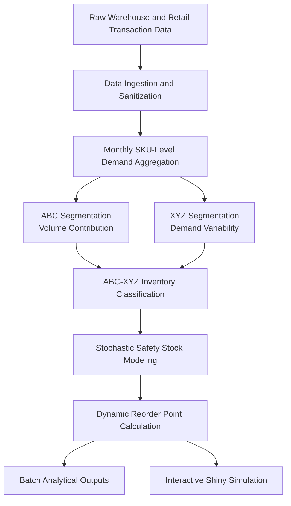
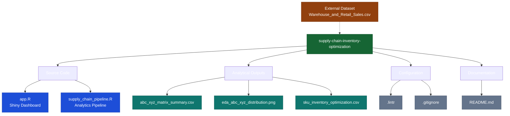
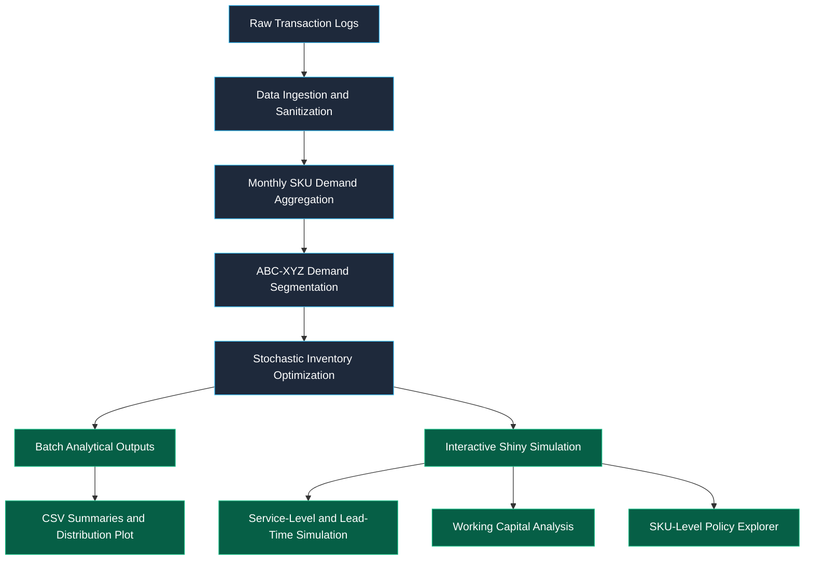

# Supply Chain Inventory Optimization
### ABC-XYZ Demand Segmentation & Stochastic Inventory Policy Engine

An end-to-end R analytics pipeline and interactive Shiny application for analyzing SKU-level demand patterns, segmenting inventory using the ABC-XYZ framework, and evaluating stochastic Safety Stock and Reorder Point (ROP) policies under demand and supplier lead-time uncertainty.

The project combines supply chain analytics, statistical demand classification and inventory policy simulation to translate historical warehouse and retail movement data into actionable replenishment insights.

---

## Project Overview

Managing thousands of SKUs creates a difficult inventory planning problem.

High-volume products require reliable replenishment to reduce stockout exposure, while low-velocity and unpredictable products can tie up working capital through unnecessary inventory.

This project addresses that challenge through a structured analytical workflow:

- Analyze historical SKU-level outbound movement.
- Classify products using ABC analysis based on cumulative volume contribution.
- Classify demand predictability using XYZ analysis and the Coefficient of Variation.
- Calculate stochastic Safety Stock using both demand and supplier lead-time variability.
- Derive dynamic Reorder Points based on target Cycle Service Levels.
- Explore inventory policy trade-offs through an interactive Shiny simulation.

The objective is to move beyond static inventory thresholds and evaluate replenishment policies according to demand characteristics and service-level requirements.

---

## Executive Summary

The analysis covers **38,236 catalog SKUs** and reveals a highly concentrated demand distribution alongside substantial variation in SKU-level demand predictability.

### Key Findings

| Metric | Result |
|---|---:|
| Total SKUs analyzed | 38,236 |
| Class A SKUs | 1,486 |
| Class A share of catalog | 3.9% |
| Class AX SKUs | 1,182 |
| High-volume volatile SKUs (AY/AZ) | 304 |
| Class C SKUs | 33,690 |
| Class C share of catalog | 88.1% |
| Class CZ SKUs | 4,499 |

### What the Results Suggest

**1. Demand concentration**

Just 1,486 SKUs, representing approximately 3.9% of the catalog, account for over 80% of aggregate outbound volume.

Within this group, 1,182 SKUs fall into the AX segment: high-volume products with relatively stable demand.

These products are strong candidates for more standardized replenishment policies and closer inventory monitoring.

**2. High-volume demand variability**

The 304 SKUs classified as AY or AZ combine high volume contribution with greater demand variability.

These products warrant closer attention when setting safety-stock buffers and evaluating service-level requirements.

**3. Long-tail inventory**

Class C contains 33,690 SKUs, approximately 88.1% of the catalog, but contributes less than 5% of aggregate volume.

Of these, 4,499 SKUs fall into the CZ segment, indicating low-volume and highly variable demand patterns.

This segment provides an opportunity to investigate alternative replenishment strategies, minimum-order-quantity adjustments and made-to-order approaches.

> These findings describe the analyzed dataset. The recommended inventory strategies are analytical opportunities, not measured operational savings or guaranteed improvements.

---

## Analytical Workflow



### Workflow Components

| Stage | Description |
|---|---|
| Data ingestion | Loads and sanitizes warehouse and retail transaction records |
| Demand aggregation | Reconciles outbound movement and aggregates SKU activity monthly |
| ABC analysis | Classifies SKUs by cumulative volume contribution |
| XYZ analysis | Evaluates demand predictability using the Coefficient of Variation |
| Inventory optimization | Calculates Safety Stock and Reorder Points |
| Batch outputs | Generates classification summaries, visualizations and SKU-level policy outputs |
| Shiny application | Allows interactive evaluation of service-level and lead-time assumptions |

---

## Methodology

### 1. ABC Analysis — Demand Concentration

SKUs are ranked in descending order of total outbound volume.

The cumulative volume share determines the ABC classification.

Let:

- \(V_i\) = total outbound volume of SKU \(i\)
- \(S_i\) = cumulative volume share up to SKU \(i\)

The classification thresholds are:

\[
\text{ABC Class} =
\begin{cases}
A, & S_i \leq 0.80 \\
B, & 0.80 < S_i \leq 0.95 \\
C, & S_i > 0.95
\end{cases}
\]

| Class | Cumulative Volume Contribution | Interpretation |
|---|---:|---|
| A | First 80% | High-volume SKUs |
| B | Next 15% | Medium-volume SKUs |
| C | Final 5% | Low-volume SKUs |

This segmentation helps distinguish products based on their contribution to total outbound volume.

### 2. XYZ Analysis — Demand Predictability

Demand variability is evaluated using the Coefficient of Variation (CV) across monthly demand observations.

\[
CV = \frac{\sigma_d}{\mu_d}
\]

Where:

- \(\sigma_d\) = standard deviation of monthly demand
- \(\mu_d\) = mean monthly demand

The implemented thresholds are:

\[
\text{XYZ Class} =
\begin{cases}
X, & CV \leq 0.50 \\
Y, & 0.50 < CV \leq 1.00 \\
Z, & CV > 1.00
\end{cases}
\]

| Class | CV Range | Interpretation |
|---|---:|---|
| X | CV ≤ 0.50 | Stable and predictable |
| Y | 0.50 < CV ≤ 1.00 | Variable demand |
| Z | CV > 1.00 | Highly variable or sporadic |

Combining ABC and XYZ produces nine inventory segments, each representing a different combination of volume contribution and demand predictability.

### 3. Stochastic Safety Stock Modeling

Traditional safety-stock calculations often assume that supplier lead time is constant.

This project extends the calculation to account for both demand variability and supplier lead-time variability.

The implemented model is:

\[
SS = Z \cdot
\sqrt{
\bar{L}\sigma_d^2 +
\bar{d}^{\,2}\sigma_L^2
}
\]

Where:

| Variable | Description |
|---|---|
| \(SS\) | Safety Stock |
| \(Z\) | Standard normal quantile associated with the target CSL |
| \(\bar{d}\) | Mean monthly demand |
| \(\sigma_d\) | Standard deviation of monthly demand |
| \(\bar{L}\) | Mean supplier lead time in months |
| \(\sigma_L\) | Standard deviation of supplier lead time in months |

The service-level multiplier is:

\[
Z = \Phi^{-1}(CSL)
\]

Where \(CSL\) represents the target Cycle Service Level.

The formulation uses an independence approximation between demand and lead-time variability. Its practical validity depends on the assumptions and units used in the underlying data.

### 4. Dynamic Reorder Point

The Reorder Point represents the inventory position at which replenishment should be initiated.

\[
ROP = (\bar{d} \times \bar{L}) + SS
\]

The model combines expected demand during replenishment lead time with the calculated safety-stock buffer.

This allows reorder policies to respond to changes in demand variability, supplier lead time and target service level.

### 5. Working Capital and Carrying Cost

The project also evaluates the financial implications of holding safety stock.

Safety-stock capital is estimated as:

\[
\text{Safety Stock Capital}
=
\sum_i (SS_i \times UnitCost_i)
\]

Annual holding cost is estimated as:

\[
\text{Annual Holding Cost}
=
\text{Safety Stock Capital} \times H
\]

Where \(H\) is the assumed annual inventory carrying-cost rate.

The model uses an illustrative carrying-cost range of 18%–25%, covering factors such as capital cost, warehousing, insurance and obsolescence.

The financial outputs depend on the unit-cost inputs and carrying-cost assumptions used in the implementation.

---

## Interactive Shiny Simulation

The project includes an interactive Shiny application designed to explore inventory policy trade-offs.

### Simulation Capabilities

- **Cycle Service Level Control:** Adjust target service levels from 80% to 99.9%.
- **Lead-Time Sensitivity:** Explore changes in supplier lead-time assumptions and variability.
- **Working Capital Analysis:** Examine the capital implications of safety-stock requirements.
- **Holding Cost Evaluation:** Observe how inventory carrying-cost assumptions affect modeled costs.
- **SKU-Level Policy Explorer:** Search and inspect individual SKU inventory recommendations using DT.

The simulation makes it possible to evaluate how inventory policy assumptions affect calculated replenishment requirements.

### Analytical Visualization


*ABC-XYZ segmentation distribution across the analyzed SKU catalog.*

---


## Repository Structure




## Architectural Pipeline



---


### External Dataset

The raw source file is not committed to this repository because of its size.

**Dataset:** Montgomery County Warehouse and Retail Sales

Download: [Warehouse and Retail Sales Dataset — Kaggle](https://www.kaggle.com/datasets)

After downloading, place the file named `Warehouse_and_Retail_Sales.csv` in the repository root directory.

---

## Technology Stack

| Technology | Purpose |
|---|---|
| R | Core analytics and data processing |
| tidyverse | Data manipulation and transformation |
| lubridate | Date and time handling |
| scales | Visualization formatting |
| Shiny | Interactive application development |
| bslib | Dashboard interface and styling |
| DT | Interactive SKU-level data tables |
| bsicons | Interface icons |

---

## Setup and Execution

### Prerequisites

- R version 4.2.0 or higher
- The source dataset: `Warehouse_and_Retail_Sales.csv`

### 1. Clone the Repository

```bash
git clone https://github.com/AshutoshTembhekar/supply-chain-inventory-optimization.git

cd supply-chain-inventory-optimization
```

### 2. Install Dependencies

Open R or RStudio and execute:

```r
install.packages(c(
  "tidyverse",
  "lubridate",
  "scales",
  "shiny",
  "bslib",
  "DT",
  "bsicons"
))
```

### 3. Add the Source Dataset

Place `Warehouse_and_Retail_Sales.csv` in the project root directory.

### 4. Run the Batch Pipeline

Execute the data processing and optimization pipeline:

```r
source("supply_chain_pipeline.R")
```

The pipeline generates the analytical outputs, including the ABC-XYZ summary, distribution visualization and SKU-level inventory optimization results.

### 5. Launch the Shiny Application

Run:

```r
shiny::runApp("app.R")
```

The interactive application will open in your default browser.

---

## Limitations and Assumptions

- The analysis depends on the quality, completeness and temporal coverage of the source transaction data.
- ABC classifications are based on historical outbound volume and do not directly measure profitability or revenue contribution.
- XYZ classification depends on the selected monthly aggregation period and CV thresholds.
- The stochastic safety-stock formulation uses an independence approximation between demand and supplier lead-time variability.
- Replenishment recommendations are model outputs and should be evaluated against actual supplier constraints, operational policies and inventory conditions.
- Working-capital and holding-cost estimates depend on the unit-cost basis and carrying-cost assumptions.
- Historical demand patterns do not guarantee future demand behavior.

---

## Potential Extensions

- Integrate demand forecasting for future inventory planning.
- Introduce SKU-specific service-level policies.
- Compare alternative inventory optimization models.
- Add supplier performance and lead-time reliability analysis.
- Extend the dashboard with historical demand trends and inventory risk monitoring.
- Evaluate replenishment policies using backtesting and simulated stockout scenarios.

---

## Author

**Ashutosh Tembhekar**

Supply Chain Analytics | Data Analytics | Statistical Modeling

- GitHub: [AshutoshTembhekar](https://github.com/AshutoshTembhekar)
- LinkedIn: [Ashutosh Tembhekar](https://www.linkedin.com/in/ashutoshtembhekar/)

---

