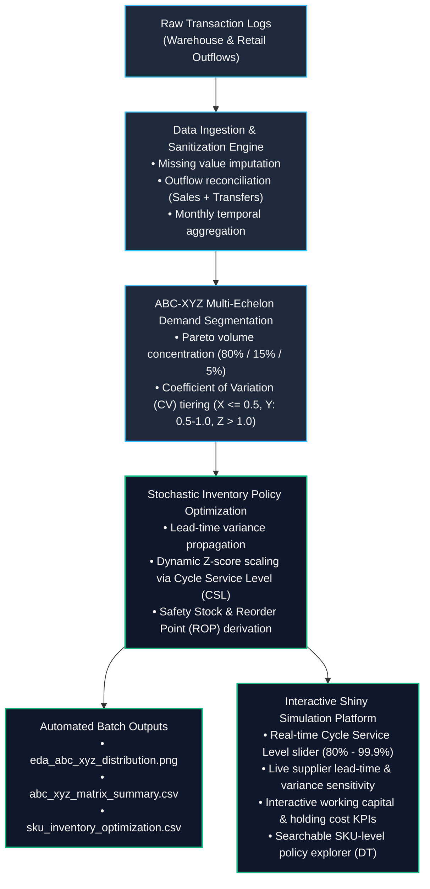

# Enterprise Supply Chain Analytics: Stochastic Inventory Optimization Engine

An end-to-end R analytics pipeline and interactive Shiny simulation platform. This system ingests multi-year transactional retail sales and warehouse movement logs, executes multi-echelon demand segmentation using an ABC-XYZ Matrix, and calculates stochastic Safety Stock and dynamic Reorder Points (ROP) under simultaneous demand and supplier lead-time uncertainty.

---

## Data Source

The raw transaction dataset (`Warehouse_and_Retail_Sales.csv`) exceeds GitHub's direct upload threshold.
* **Download:** [Retail Sales Dataset on Kaggle](https://www.kaggle.com/) *(Montgomery County Warehouse and Retail Sales)*
* **Setup:** Place `Warehouse_and_Retail_Sales.csv` in the project root directory before running the batch pipeline or Shiny application.

---

## Executive Summary & Core Insights

Analysis across **38,236 catalog SKUs** highlights significant demand skewness and volatility clustering:

* **Class A Concentration (3.9% of SKUs):** Over 80% of aggregate outbound volume is driven by 1,486 items. Among these, **1,182 SKUs belong to Class AX** (high volume, low volatility), representing the primary candidates for Automated Replenishment Programs, Vendor-Managed Inventory (VMI), and Just-In-Time (JIT) scheduling.
* **Top-Line Stockout Vulnerability (AY / AZ - 304 SKUs):** High-volume items characterized by volatile or sporadic order profiles require buffered safety stock to mitigate stockouts against key revenue drivers.
* **Long-Tail Rationalization (Class C - 88.1% of SKUs):** 33,690 low-velocity SKUs contribute under 5% of aggregate system volume. **4,499 SKUs reside in Class CZ** (erratic/lumpy demand), identifying opportunities for supplier SKU rationalization, minimum order quantity (MOQ) re-negotiations, or shifting toward Made-to-Order (MTO) fulfillment to release trapped working capital.

---

## Architectural Pipeline

---

## Mathematical Formulation

### 1. ABC Segmentation (Pareto Principle)
SKUs are sorted descending by cumulative total volume $V_i$. The cumulative volume share $S_i$ establishes the classification tier:

$$\text{Class} = \begin{cases} A, & S_i \le 0.80 \\ B, & 0.80 < S_i \le 0.95 \\ C, & S_i > 0.95 \end{cases}$$

### 2. XYZ Segmentation (Demand Predictability)
Evaluated across monthly aggregation windows using the statistical **Coefficient of Variation (CV)**:

$$CV = \frac{\sigma_d}{\mu_d}$$

$$\text{Volatility Tier} = \begin{cases} X \text{ (Stable / Predictable)}, & CV \le 0.50 \\ Y \text{ (Variable / Seasonal)}, & 0.50 < CV \le 1.00 \\ Z \text{ (Sporadic / Lumpy)}, & CV > 1.00 \end{cases}$$

### 3. Stochastic Safety Stock Modeling
To prevent stockouts during replenishment cycles, the
